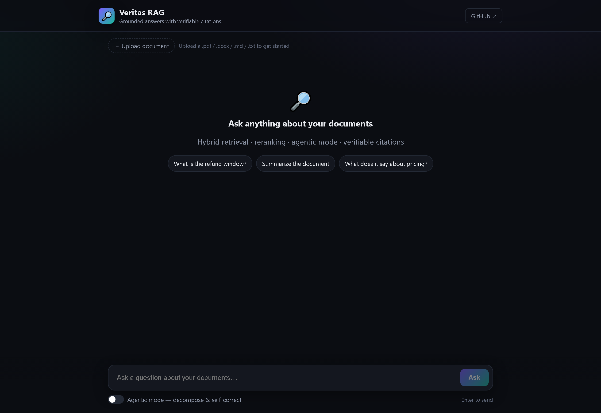

<h1 align="center">🔎 Veritas RAG</h1>

<p align="center">
  <b>A production-grade, model-agnostic Retrieval-Augmented Generation platform</b><br>
  Answers questions over your documents with <b>verifiable citations</b> — built around
  hybrid retrieval, reranking, an agentic layer, and a real evaluation framework.
</p>

<p align="center">
  
  
  
  
  
</p>

---

## Demo



A chat UI with document upload, **streamed** answers, inline **source citations**, and an
**agentic mode** that surfaces the agent's reasoning steps and a faithfulness score. The backend
runs with **zero external services** (fake provider + in-memory store) for instant local demos, or
with OpenAI + pgvector in production.

```bash
# backend  →  http://localhost:8000/docs
cd backend && pip install -r requirements.txt && uvicorn app.main:app --port 8000
# frontend →  http://localhost:3000   (new terminal)
cd frontend && npm install && npm run dev
```

## Why this project

Most RAG demos are a thin wrapper around an LLM: `embed → cosine similarity → prompt`.
In practice, the hard parts are **retrieval quality**, **evaluation of a non-deterministic system**,
and **not hallucinating**. Veritas RAG is built to take those seriously:

- **Grounded answers with citations** — every answer links back to the source chunk; the model is
  instructed to say *"I don't know"* when the context doesn't contain the answer.
- **Advanced retrieval** — hybrid search (vector + keyword) with cross-encoder **reranking**, plus
  query rewriting / decomposition.
- **Agentic layer** — a multi-step agent that decides when to retrieve and self-corrects.
- **Evaluation framework** — a golden set + metrics (faithfulness, answer relevancy, context recall)
  so retrieval strategies can be compared, not guessed.
- **Observability** — tracing of retrieved chunks, latency and **token cost per query**.
- **Production concerns** — JWT auth, multi-tenancy, Redis caching, Docker, CI, tests.

> This is a learning-grade project built in the open to demonstrate engineering depth in RAG.

---

## Architecture

```
          ┌──────────────────────────────┐
          │       Frontend (Next.js)      │
          │ chat · upload · sources ·     │
          │ evals / cost dashboard        │
          └───────────────┬──────────────┘
                          │ REST / SSE (streaming)
          ┌───────────────▼──────────────┐
          │       API (FastAPI)           │
          │ auth · rate-limit · tenancy   │
          └───┬──────────────────────┬────┘
              │                      │
   ┌──────────▼─────────┐  ┌─────────▼──────────────┐
   │ Ingestion pipeline  │  │     RAG engine          │
   │ parse·chunk·embed · │  │ rewrite → hybrid        │
   │ async workers       │  │ retrieve → rerank →     │
   └──────────┬──────────┘  │ LLM → verify/cite       │
              │             └───────────┬────────────┘
              ▼                         │
   ┌──────────────────────┐            │
   │ PostgreSQL + pgvector │◄───────────┘
   └──────────┬───────────┘
              ▼
   ┌──────────────────────┐   ┌──────────────────────┐
   │   Redis (cache/queue) │   │ Observability (trace, │
   └──────────────────────┘   │ token cost, evals)    │
                              └──────────────────────┘
```

See [ARCHITECTURE.md](ARCHITECTURE.md) for design decisions and trade-offs.

---

## Tech stack

| Layer | Tech |
|---|---|
| Frontend | Next.js · React · Tailwind CSS |
| Backend | Python · FastAPI |
| LLM orchestration | LangChain / LangGraph |
| Vector DB | PostgreSQL + pgvector |
| Keyword search | Postgres full-text (hybrid) |
| LLM & embeddings | OpenAI / Gemini / Anthropic (**model-agnostic**, via config) |
| Cache / queue | Redis |
| Evaluation | golden set + RAGAS-style metrics |
| Infra | Docker Compose · GitHub Actions CI |
| Tests | pytest |

---

## Roadmap

- [x] **Phase 1 — MVP:** upload (PDF/DOCX/MD/TXT), ingestion pipeline, vector retrieval, cited
  answers, streaming, "I don't know" · *pluggable providers (fake/OpenAI) + vector backends
  (in-memory/pgvector) so it runs & tests with zero external services*
- [x] **Phase 2 — Advanced retrieval:** hybrid search (vector + keyword) fused with **RRF**,
  **reranking** (fake + cross-encoder), query rewriting · all strategy toggles in config
- [x] **Phase 3 — Evaluation & observability:** golden-set eval runner (faithfulness, answer
  relevancy, context precision/recall + citation accuracy) via `evals/run_evals.py`, plus per-query
  tracing of latency & token cost at `GET /api/traces` and `GET /api/stats`
- [x] **Phase 4 — Agentic:** multi-step agent (`POST /api/ask/agentic`) — query decomposition,
  multi-query retrieval, faithfulness self-check and self-correction, with inspectable reasoning steps
- [x] **Phase 5 — Production:** JWT auth (`/auth/register`,`/login`,`/me`), **multi-tenant isolation**,
  per-IP rate limiting, answer caching (in-memory/Redis), CI, and a **Next.js chat frontend**
  (upload, citations, agentic mode)

---

## Quick start (local)

> Requires Docker. Copy `.env.example` to `.env` and add your LLM API key.

```bash
cp .env.example .env         # then edit .env with your API key
docker compose up --build
# API docs:      http://localhost:8000/docs
# Frontend:      http://localhost:3000
```

Or run the backend directly:

```bash
cd backend
python -m venv .venv && source .venv/bin/activate   # Windows: .venv\Scripts\activate
pip install -r requirements.txt
uvicorn app.main:app --reload
```

---

## API

| Method | Endpoint | Purpose |
|---|---|---|
| POST | `/auth/register` · `/auth/login` | get a JWT (creates a tenant) |
| GET  | `/auth/me` | current user / tenant |
| POST | `/api/documents/upload` | ingest a document (tenant-scoped) |
| POST | `/api/ask` | grounded answer with citations (cached) |
| POST | `/api/ask/stream` | streamed answer (SSE) |
| POST | `/api/ask/agentic` | decompose → retrieve → self-correct, with steps |
| GET  | `/api/traces` · `/api/stats` | per-query traces, latency & token cost |

Interactive docs at `/docs`.

## Project structure

```
veritas-rag/
├── backend/
│   └── app/
│       ├── api/           routes: auth, documents, query, traces
│       ├── core/          chunking, parsing, fusion (RRF), rerank, query_transform
│       ├── providers/     embeddings + chat (fake / OpenAI), model-agnostic
│       ├── vectorstore/   in-memory + pgvector backends
│       ├── services/      ingestion, rag
│       ├── agent/         agentic controller (decompose + self-correct)
│       ├── eval/          RAGAS-style metrics + runner
│       ├── observability/ per-query tracing (latency, token cost)
│       ├── auth/          JWT + password hashing + tenant resolution
│       └── middleware/    rate limiting
├── frontend/              Next.js chat UI (upload, citations, agentic mode)
├── evals/                 golden set + CLI eval runner
├── docker-compose.yml     db (pgvector) · redis · backend · frontend
└── ARCHITECTURE.md
```

---

## Author

**Nicolae Cristian Lapușneanu** — [LinkedIn](https://www.linkedin.com/in/nicolae-lapusneanu/) ·
[GitHub](https://github.com/LapusneanuNicolae) · niculapusneanu1@gmail.com
